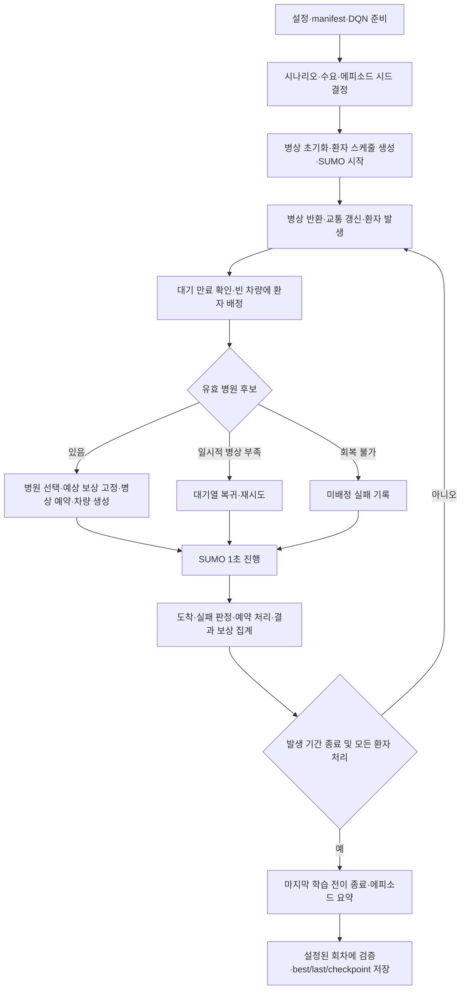

# 구급차 병원 배정 강화학습 프로그램 상세 설명

이 문서는 2026-11-11의 v5 구현과 당시 평가 결과를 보존한 기록입니다. 현재 v6 실행 방법과 변경 사항은 [v6 구현·실험 안내](v6_implementation_2026_11_13.md)를 참고하세요.
작성일: 2026-11-11  
기준: 현재 저장소의 `CODE/` 실행 코드, v5 실험 manifest, 저장된 체크포인트와 평가 로그

이 문서는 연구 설명과 코드 이해, 실험 재현을 위한 현행 구현 설명서다. 현재 실행에 사용하는 최상위 `CODE/*.py`를 기준으로 작성했다. 구현 사실, 합성 환경의 가정, 관측된 평가 결과, 앞으로 검증할 과제를 구분한다.

## 목차

1. 연구 목적과 현재 구현 범위
2. 현재 버전과 실험 설정
3. 폴더와 주요 파일
4. 입력 데이터와 병원·도로 준비
5. 환자 발생과 시나리오
6. 에피소드 실행 흐름
7. 대기열과 구급차 운행
8. 병상 예약과 반환
9. MDP와 관측 벡터
10. 행동 공간과 병원 후보 마스크
11. 보상함수 전체
12. DQN 구조와 학습 방식
13. 검증과 비교 정책
14. 실행 방법
15. 모델 저장·재개와 실험 재현
16. 로그와 평가 지표
17. 현재 18회·54회 실험 결과
18. 테스트와 진단 도구
19. 구현의 한계와 후속 과제
20. 관련 문서

## 1. 연구 목적과 현재 구현 범위

이 프로그램은 SUMO 도로 교통 시뮬레이션에서 발생한 환자를 어느 병원으로 이송할지 결정하는 연구용 시스템이다. 예상 이동시간뿐 아니라 중증도별 병원 적합도, 병상 점유율, 대기와 동시 이송의 영향을 함께 고려하는 정책을 학습한다.

시스템 전체에 DQN 에이전트 하나를 둔다. 여러 구급차가 동시에 운행하지만, 각 환자를 배정할 때 하나씩 병원을 선택한다.

| 구분 | 현재 담당 |
|---|---|
| 병원 선택 | DQN 또는 비교 정책 |
| 환자 처리 순서 | severity/FIFO/hybrid 대기열 규칙 |
| 구급차 동시 운행 제한 | MissionManager |
| 병원까지 주행과 교통 상호작용 | SUMO |
| 경로 후보와 예상 이동시간 | TraCI findRoute와 TrafficRouter |
| 예약·치료·병상 반환 | HospitalCapacity |
| 환자 결과 채점 | 보상 버전 4 |
| 학습 경험 연결 | 병원 선택 순서의 EpisodeTransitions |

구급차는 환자 발생 도로에서 생성된다. 차고지에서 현장까지의 출동, 현장 처치, 병원에서 차고지로 복귀, 차량별 재배치는 모델링하지 않는다. 도착 시 운행 한도가 다시 확보되며, 병원 치료 병상은 별도의 시간 동안 유지된다.

`arrived`는 선택 병원까지 이송했다는 뜻이다. 치료 성공, 생존율, 임상 예후를 뜻하지 않는다.

## 2. 현재 버전과 실험 설정

버전 번호는 각각 다른 의미다.

| 항목 | 현재 값 |
|---|---|
| 실험 버전 EXPERIMENT_VERSION | 5 |
| 관측 스키마 STATE_SCHEMA_VERSION | 4 |
| 보상 버전 reward_version | 4 |
| replay 스키마 REPLAY_SCHEMA_VERSION | 3 |
| 네트워크 architecture | hospital_shared_v5 |
| 관측 차원 | 공통 16 + 병원당 9 |
| 학습 보상 스케일 | 원래 보상 / 100 |

현재 비교한 실험의 signature는 `3e44a827e947b192`다. 설정 근거는 [실험 manifest](../results/training/experiment_v5_3e44a827e947b192.json)다.

| 설정 | 코드 기본값 | 현재 18회·54회 실험 |
|---|---:|---|
| 환자 발생 기간 arrival_steps | 500초 | 500초 |
| 기본 수요 배율 demand_scale | 1.0 | 1.0 |
| 커리큘럼 | 없음 | 0.1, 0.3 순환 |
| 구급차 한도 | 10대 | 10대 |
| 가상 병원 수 | 0개 | 2개 |
| 가상 병원 배치 | far, 시드 42 | far, 시드 42 |
| 병원 수 | 환경 준비 결과에 따라 결정 | 실제 데이터 병원 7 + 가상 2 = 9 |
| 입력/행동 차원 | 16+9H / H | 97 / 9 |
| 대기열 정책 | severity | severity |
| 최대 배정 대기 max_wait | 1,800초 | 1,800초 |
| 배정 후 이송 제한 mission_timeout | 1,800초 | 1,800초 |
| 도착 후 병상 유지 treatment_seconds | 900초 | 900초 |
| 환자 1명 병상 비율 bed_fraction | 0.08 | 0.08 |
| 병상 점유율 상한 occupancy_limit | 0.85 | 0.85 |
| 검증 시드 | 30001,30002,30003 | 30001 |
| 검증 시나리오 | 1 | 1 |
| 검증 수요 | 기본 demand_scale | 0.1,0.3 |
| 미완료 임무 예상 보상 특징 | estimate | estimate |
| 학습 기본 시드 | 42 | 42 |
| 검증된 환자 발생 도로 수 상한 | 1,200 | 실제 1,200개 |

`--virtual-count 2`, 커리큘럼, 검증 수요 등은 실행 옵션으로 선택한 값이다. 모든 실행에 자동 적용되는 기본값은 아니다.

## 3. 폴더와 주요 파일

| 경로 | 역할 |
|---|---|
| [CODE/train_agent.py](../CODE/train_agent.py) | 학습 CLI, 시나리오·커리큘럼 순환, 검증, best/last/checkpoint 저장 |
| [CODE/run_scenarios.py](../CODE/run_scenarios.py) | 동일 환경·시드·수요에서 정책 비교 |
| [CODE/simulation.py](../CODE/simulation.py) | 학습·검증·비교 평가가 공통으로 사용하는 에피소드 엔진 |
| [CODE/experiment_config.py](../CODE/experiment_config.py) | 설정 검증, 시나리오, 시드, 환자 발생 스케줄, 커리큘럼 |
| [CODE/simulation_setup.py](../CODE/simulation_setup.py) | SUMO 시작, 병원·도로 도달성 검증, 가상 병원, manifest와 모델 복원 |
| [CODE/environment.py](../CODE/environment.py) | 도로망과 병원 JSON·POI 로드, 좌표 변환 |
| [CODE/ambulance_sim.py](../CODE/ambulance_sim.py) | 환자 대기열, 차량 생성, 동시 임무, 도착·실패 판정, 공통 시계 |
| [CODE/hospital_capacity.py](../CODE/hospital_capacity.py) | 병상 예약, 도착 후 치료 전환, 시간 경과 후 반환 |
| [CODE/hospital_policy.py](../CODE/hospital_policy.py) | KTAS·경로·병상에 따른 병원 후보 제외 |
| [CODE/traffic_router.py](../CODE/traffic_router.py) | 관측한 도로 속도를 경로 탐색 비용에 반영 |
| [CODE/baseline.py](../CODE/baseline.py) | 관측 벡터 생성, 비교 정책 |
| [CODE/reward.py](../CODE/reward.py) | 골든타임, 병원 적합도, 성공·실패 보상 |
| [CODE/dqn_agent.py](../CODE/dqn_agent.py) | Q 네트워크, 유효 행동 선택, replay, Double DQN 업데이트, 저장·복원 |
| [CODE/episode_transitions.py](../CODE/episode_transitions.py) | 병원 선택 사이에 환자 결과를 모아 전이 저장 |
| [CODE/experiment_log.py](../CODE/experiment_log.py) | 실행·환자·선택·평가 기록을 CSV에 추가 |
| [CODE/training_graphs.py](../CODE/training_graphs.py) | 학습 요약 CSV와 대시보드 PNG |
| [CODE/compare_queue_policies.py](../CODE/compare_queue_policies.py) | 학습된 DQN으로 FIFO/severity/hybrid 비교 |
| [CODE/diagnose_learning.py](../CODE/diagnose_learning.py) | replay 보상 감사와 작은 환경의 학습 진단 |
| [CODE/diagnose_overlap.py](../CODE/diagnose_overlap.py) | 결과 지연·동시 임무·관측 보강 통제 실험 |
| [CODE/gui_ambulance_camera.py](../CODE/gui_ambulance_camera.py) | GUI 구급차 추적 카메라 보조 클래스 |
| DATASET/ | 병원 위치 JSON·CSV, 소방서·안전센터·구조대 위치 XLSX |
| SUMO/강남/ | 도로망, 배경 교통, 병원·소방서 POI, SUMO 설정 |
| make_xml/ | 지도 표시·차량 등 SUMO 입력을 만드는 보조 스크립트 |
| results/ | 모델, 체크포인트, 실험 로그, SUMO 출력, 진단 결과 |
| tests/ | 주요 로직의 회귀 테스트 |
| CODE/gpt/ | 별도 복사본·이전 코드. 아래 실행 명령의 기준은 최상위 CODE/ |

소방서 POI와 별도 차량 XML이 존재해도 현재 학습에서 차량이 소방서부터 환자까지 이동하는 것은 아니다. 연구 관리 차량은 `amb_e_`, `amb_eval_` 계열 ID로 구분한다.

## 4. 입력 데이터와 병원·도로 준비

### 4.1 실제 사용하는 입력

- 도로망: `SUMO/강남/osm.net.xml.gz`가 있으면 우선 사용하고, 없으면 `osm.net.xml`을 사용한다.
- SUMO 설정: `SUMO/강남/osm.sumocfg`.
- 병원 원본: `DATASET/서울시 응급실 위치 정보.json`의 DATA 배열.
- 병원 표식: `SUMO/강남/hospitals.add.xml`.
- 배경 교통: SUMO 설정에 연결된 `osm.passenger.trips.xml` 등의 입력.

병원은 JSON과 병원 POI에 공통으로 존재하는 ID를 기준으로 읽는다. 좌표 오류·중복·도로망 범위 밖·주변 emergency 도로가 없는 항목을 제외하고, 병원 ID 순으로 정렬한다.

병원 POI는 지도 표식이다. 실제 도착지는 병원 주변의 주행 가능한 도로 edge다. 환자가 병원 건물 내부까지 이동하는 모델은 아니다.

### 4.2 환경 준비 순서

1. SUMO를 초기 실행하고 구급차 차종 `ambulance_custom`을 만든다.
2. 병원 좌표를 SUMO 좌표로 변환한다.
3. 병원 주변 반경 1,200m에서 emergency 주행 가능 접근 도로를 최대 12개 찾는다.
4. 방향성 도로 그래프를 역탐색하고, 표본 출발지에서 TraCI 경로 탐색으로 병원 도달성을 확인한다.
5. 요청한 가상 병원을 추가한다.
6. 적어도 한 병원에 도달할 수 있는 환자 발생 도로를 검증해 최대 candidate_limit개 확보한다.
7. 병원 순서·좌표·접근 도로·환자 발생 도로를 manifest에 저장한다.

초기 도달성 검증은 모든 환자가 모든 병원에 도달한다는 보장이 아니다. 실제 배정 시 환자 도로에서 각 병원까지 다시 확인한다. 발생 도로 검증도 모든 KTAS에 맞는 병원을 보장하지 않으므로, 중증도 마스크 적용 후 후보가 사라질 수 있다.

### 4.3 현재 9개 병원

아래 유형은 저장된 실험 데이터의 값이다. 실제 의료기관의 현행 공식 지정 상태를 새로 확인한 목록은 아니다.

| 행동 인덱스 | ID | 이름 | 저장된 유형 |
|---:|---|---|---|
| 0 | A1100004 | 순천향대학교 부속 서울병원 | 지역응급의료센터 |
| 1 | A1100012 | 가톨릭대학교 서울성모병원 | 지역응급의료센터 |
| 2 | A1100015 | 강남세브란스병원 | 지역응급의료센터 |
| 3 | A1100018 | 베스티안서울병원 | 응급실운영신고기관 |
| 4 | A1100057 | 강남차병원 | 응급실운영신고기관 |
| 5 | A1100141 | 강남베드로병원 | 권역응급의료센터 |
| 6 | A1123234 | 강남더드림병원 | 응급실운영신고기관 |
| 7 | VIRTUAL_FAR_42_01 | 가상 권역응급의료센터 1 | 권역응급의료센터 |
| 8 | VIRTUAL_FAR_42_02 | 가상 권역응급의료센터 2 | 권역응급의료센터 |

### 4.4 가상 병원 배치

`--virtual-count`는 0, 2, 5 중 선택한다. 모든 가상 병원의 유형은 권역응급의료센터다.

| 전략 | 배치 점수 |
|---|---|
| far | 실제 병원과의 최근접 거리 제곱이 큰 후보 우선 |
| random | 고정 배치 시드로 생성한 무작위 점수 |
| demand-proxy | 주변 잠재 환자 발생 도로 후보의 밀도 |

최대 800개 도로 후보에서 위치를 찾고, 실제·이미 선택한 가상 병원과 기본 1,300m 간격을 검사하며, 실제 경로 도달성도 확인한다. far는 실제 병원 기준 점수로 순위를 만든 뒤 추가 병원과의 간격을 검사하는 방식이며, 전역 배치 최적화를 수행하지 않는다. demand-proxy도 실제 신고 건수나 KTAS 1·2 수요를 사용한 배치가 아니다.

### 4.5 교통을 반영한 경로

TrafficRouter는 시뮬레이션 시간 30초마다 차량이 관측되는 도로의 평균 속도를 확인한다.

```text
도로 비용 = max(도로 길이 / 제한속도,
                도로 길이 / max(관측 평균속도, 1m/s))
```

차량 구독 결과와 도로 형상 캐시를 사용해 전체 도로를 매초 조회하는 비용을 줄인다. 이전에 관측됐으나 현재 차량이 없는 도로는 자유 주행 비용으로 되돌린다.

배정 시 각 병원의 접근 도로 후보를 비교해 예상 시간이 가장 짧은 경로를 선택한다. 이 경로의 길이가 최단거리 정책의 비교 대상이 된다. 따라서 최단거리 정책은 병원별 공통 후보 경로의 길이를 최소화하며, 모든 가능한 도로 경로에 대해 별도의 전역 거리 최적화를 하는 것은 아니다. 선택 경로를 차량 생성에도 재사용한다.

## 5. 환자 발생과 시나리오

### 5.1 9개 시나리오

| 시나리오 | 기본 초당 발생 확률 | 배경 교통량 배율 |
|---:|---:|---:|
| 1 | 0.2 | 0.3 |
| 2 | 0.2 | 0.5 |
| 3 | 0.2 | 0.8 |
| 4 | 0.3 | 0.3 |
| 5 | 0.3 | 0.5 |
| 6 | 0.3 | 0.8 |
| 7 | 0.4 | 0.3 |
| 8 | 0.4 | 0.5 |
| 9 | 0.4 | 0.8 |

기본 학습은 누적 에피소드 번호에 따라 1~9번을 반복한다. `--train-scenarios 6`이면 6번만, `--train-scenarios 2,6`이면 해당 순서만 반복한다. 매 에피소드의 시드는 계속 달라진다. 교통량 배율은 SUMO의 `--scale`에 전달되며, 환자 수요 배율과 별개다.

### 5.2 발생 확률과 중증도

```text
실제 초당 발생 확률
  = 시나리오 기본 확률 × demand_scale × 커리큘럼 배율
예상 발생 인원
  = arrival_steps × 실제 초당 발생 확률
```

기본 첫 500초 동안 매초 최대 한 명이 발생한다. 위치는 검증된 도로에서 균등 선택하고, KTAS 1~5도 각각 20% 확률로 생성한다. pre_ktas는 생성 KTAS와 같은 값이다. 실제 신고의 시간대·인구·상권·공간 밀도는 반영하지 않는다.

시나리오 1에서 수요 0.1이면 초당 확률 0.02, 500초 기대 인원 10명이다. 수요 0.3이면 확률 0.06, 기대 인원 30명이다. 이는 합성 실험의 기대값이며 강남구의 실제 환자 발생률 추정치가 아니다.

### 5.3 시드와 커리큘럼

- 학습 에피소드 시드: `기본 seed + 10000 + 누적 에피소드 번호`.
- 발생 여부: 에피소드 시드를 쓰는 별도 난수 스트림.
- 도로·KTAS 속성: 에피소드 시드 + 100000.
- 병원 초기 점유율: 에피소드 시드 + 200000.
- 가상 병원 배치: placement_seed.

같은 시드에서 부하를 올리면 낮은 부하의 발생 환자가 높은 부하에 포함되며, 공통 발생 시점의 도로·KTAS도 유지된다. 따라서 두 수요 조건의 환자 표본은 서로 완전히 독립적이지 않다.

커리큘럼 `0.1,0.3`은 9회마다 배율을 바꾼다. 순환 옵션을 사용하면 1~9회는 0.1, 10~18회는 0.3, 19~27회는 다시 0.1이다. 재개해도 누적 번호로 이어진다. 순환 옵션이 없으면 마지막 배율을 유지한다.

## 6. 에피소드 실행 흐름



병원이 선택될 때 이전 선택 구간의 학습 전이가 저장된다. 최종 전이는 에피소드 종료 시 저장한다.

실제 루프는 안전 종료 경계도 검사한다.

```text
drain_deadline = arrival_steps + max_wait + mission_timeout + 2
기본값         = 500 + 1800 + 1800 + 2 = 4102초
```

500초가 지나면 환자 발생만 끝난다. 대기·운행 환자가 남으면 계속 처리하고, 환자가 모두 처리돼도 발생 기간 전에는 새 환자를 기다린다. 치료 병상 반환만 남은 상태는 에피소드를 계속할 이유가 되지 않는다.

안전 경계까지 남은 환자는 censored로 구분한다. 현재 구조는 고정된 500초에 모든 환자 결과를 잘라버리는 방식과 다르다.

## 7. 대기열과 구급차 운행

### 7.1 대기열 규칙

| 정책 | 선택 순서 |
|---|---|
| severity | KTAS 숫자가 작은 환자 우선, 같으면 발생 시각 우선 |
| fifo | 발생 시각 우선 |
| hybrid | `KTAS − 대기시간 / aging_seconds`가 작은 환자 우선 |

hybrid는 기다릴수록 우선순위를 높인다. 기본 aging_seconds는 300초다. 환자 처리 순서는 DQN이 학습하는 행동이 아니다.

### 7.2 운행과 실패 처리

한 시점에 연구 관리 임무를 최대 10개까지 유지한다. 빈 차량 한도가 있으면 같은 SUMO 시각에도 여러 환자를 순차 배정할 수 있다. MissionManager.step이 공통 시계를 1초 진행한 뒤 모든 운행 임무의 도착·실패를 검사한다.

| 결과 | 의미 |
|---|---|
| arrived | 병원 접근 도로까지 경로를 완료 |
| waiting_timeout | 발생 후 max_wait까지 배정되지 못함 |
| no_valid_hospital | 배정 시 유효 후보가 없고 일시적 병상 부족만의 문제도 아님 |
| mission_timeout | 배정 후 mission_timeout을 초과 |
| vehicle_disappeared | 한 번 출현했던 차량이 도착 기록 없이 사라짐 |
| 차량 생성 실패 | 차종·도로·경로·생성 요청 등의 문제 |
| horizon_timeout / horizon_waiting | 안전 경계에서 운행·대기를 종료한 censored |

대기 제한은 발생 시점부터, 이송 제한은 배정 시점부터 계산한다. 늦게 배정됐다고 이송 제한시간을 대기시간만큼 줄이지 않는다.

병상 부족만 해소되면 가능한 후보가 하나라도 있으면 `min(30초, treatment_seconds)` 후 재시도한다. 차량 생성 실패 시 이미 예약한 병상을 반환하고, 해당 환자 결과를 실패로 기록한다.

## 8. 병상 예약과 반환

각 병원의 점유율은 다음 합으로 계산한다.

```text
점유율 = 초기 배경 점유율
       + bed_fraction × (이송 중 예약 건수 + 치료 중 환자 수)
```

초기 배경 점유율은 에피소드마다 병원별 0.20~0.60 균등분포로 생성하며, 그 에피소드 동안 고정된다.

1. 병원 선택 직전 점유율을 관측하고 보상 계산용으로 보관한다.
2. 선택 즉시 환자 1명분을 예약한다.
3. 도착하면 예약을 해제하고 치료 중 환자 수를 늘린다. 이 순간 총점유율은 유지된다.
4. 도착 후 treatment_seconds가 지나면 치료 병상을 반환한다.
5. 이송 실패 시 예약만 해제하고 치료 환자는 추가하지 않는다.

예약 후 점유율이 상한 0.85를 넘으면 배정할 수 없다. 기본 0.08은 모든 병원에 공통인 정규화된 병상 비율이며, 병원별 실제 병상 수나 KTAS별 치료시간 차이를 표현하지 않는다. 기본 900초도 실제 임상 치료시간 추정치가 아니다.

## 9. MDP와 관측 벡터

개념적 모델은 `M = (S, A, P, R, gamma)`다. 전체 상태에는 차량 위치·도로 교통·대기 환자·이송 임무·병상 예약·반환 일정이 포함된다. DQN은 전체 상태를 받지 않고 요약 관측 `o = phi(S)`를 받는다.

| 요소 | 현재 정의 |
|---|---|
| 의사결정 시점 | 환자를 배정할 수 있고 유효 병원이 있을 때 |
| 행동 | 병원 인덱스 하나 |
| 전이 | 환자 발생·대기·배정, 교통과 운행, 도착·실패, 병상 변화 |
| 전이 보상 | 현재 선택 이후 다음 선택 전까지 관측된 환자 결과 보상 합 |
| 할인 | gamma=0.95, 선택 전이마다 적용 |
| 종료 | 발생 기간이 끝나고 모든 환자 처리 또는 안전 경계 |
| 관측의 성격 | 일부 상태를 요약한 부분 관측; 완전한 Markov 성질을 보장하지 않음 |

의사결정 간격은 불규칙하고 같은 초에 여러 결정도 가능하다. 경과 초에 따른 할인은 사용하지 않는다.

### 9.1 공통 특징 16개

| 인덱스 | 내용 | 입력 |
|---:|---|---|
| 0~1 | 환자 도로 시작 노드 x,y | 좌표 / 10000 |
| 2 | 환자 KTAS | KTAS / 5 |
| 3 | 현재 환자 대기시간 | 대기 / max_wait |
| 4 | 현재 시뮬레이션 시각 | now / drain_deadline |
| 5 | 남은 발생 기간 | max(0,arrival_steps−now) / arrival_steps |
| 6 | 현재 운행 임무 수 | 운행 수 / 구급차 한도 |
| 7 | 대기 환자 수 | 대기 수 / 100 |
| 8~12 | KTAS 1~5별 대기 환자 수 | 각각 / 100 |
| 13 | 가장 오래 대기한 시간 | 최장 대기 / max_wait |
| 14 | 운행 임무들의 남은 이송 제한시간 평균 | 평균 / mission_timeout |
| 15 | 운행 임무들의 배정 당시 예상 보상 합 | 합 / 100 |

현재 선택 중인 환자는 이미 대기열에서 꺼낸 상태이므로 대기열 통계에 포함되지 않는다. 운행 임무가 없으면 14·15번은 0이다.

### 9.2 병원별 특징 9개

병원 h의 블록은 `16 + 9h`에서 시작한다.

| 블록 내 인덱스 | 내용 | 입력 |
|---:|---|---|
| 0 | 예상 이동시간 | min(예상 초 / 600,5) |
| 1 | 예약·치료를 포함한 점유율 | 점유율 |
| 2 | 수치형 역량 | 권역센터 1.0, 지역센터 0.8, 지역기관 0.6, 그 외 0.3 |
| 3 | 현재 환자와의 병원 적합도 | 불확실성 반영 기대값 |
| 4 | 예약 병상량 | reserved_count × bed_fraction |
| 5 | 치료 중 병상량 | admitted_count × bed_fraction |
| 6 | 다음 치료 병상 반환까지 | min(남은 시간 / treatment_seconds,1) |
| 7 | 경로 도달 여부 | 1 또는 0 |
| 8 | 추가 예약 가능 여부 | 1 또는 0 |

반환 일정이 없으면 6번은 0이다. 도달 불가 병원도 상태 블록은 존재하지만 행동 마스크에서 제외된다. 정규화가 모든 값을 0~1로 제한하지는 않는다.

### 9.3 v5의 추가 관측

```text
임무별 예상 총시간 = 배정 당시 대기 + 배정 당시 예상 이동시간
임무별 예상 보상   = 보상 v4(예상 총시간, KTAS, 선택 병원, 예약 전 점유율)
관측[15]          = 현재 운행 중 임무의 예상 보상 합 / 100
```

예상 보상은 배정 시 고정한다. 실제 미래 도착시간을 미리 읽거나, 교통이 변할 때마다 재계산하지 않는다. 임무가 종료되면 합계에서 빠진다. 현재 선택할 환자의 예상 보상은 아직 포함되지 않는다.

이 값은 입력 특징이며 보상으로 추가 지급하지 않는다. 실제 결과 보상은 완료 시 기존 방식으로 한 번 반영한다.

`--pending-reward-feature zero`는 같은 97차원과 같은 네트워크를 사용하면서 15번만 0으로 만든 대조 조건이다. 이 대조 실험이 있어야 추가 특징 자체의 효과를 분리할 수 있다.

## 10. 행동 공간과 병원 후보 마스크

행동 공간은 `{0,...,H−1}`이며 현재 H=9다. 다음 조건을 모두 만족해야 선택할 수 있다.

- 환자 위치에서 병원 접근 도로까지 경로가 있다.
- 병원 종류가 정의돼 있고 현재 KTAS의 최소 역량을 충족한다.
- 점유율이 유한하고 0 이상이며 상한 미만이다.
- 추가 예약 후에도 점유율 상한을 넘지 않는다.
- accepting이 명시적으로 꺼져 있지 않다.

| KTAS | 코드의 최소 병원 역량 |
|---:|---|
| 1,2 | 권역응급의료센터 |
| 3 | 지역응급의료센터 이상 |
| 4,5 | 등록된 네 종류 모두 |

이 표는 연구용 hard mask다. 실제 임상 이송 지침으로 해석하지 않는다. 적합도 점수가 양수여도 마스크에서 제외되면 선택할 수 없다.

DQN은 유효 후보 중에서만 탐색·최대 Q 선택을 한다. 다음 상태의 학습 타깃도 다음 유효 후보 안에서 계산한다. 후보가 없을 때 유효하지 않은 병원을 임의 선택하는 동작은 없다.

## 11. 보상함수 전체

구현: [reward.py](../CODE/reward.py). 실제 적용: [simulation.py의 finish](../CODE/simulation.py).

### 11.1 변수와 성공 보상

```text
T = 환자 발생부터 도착까지 총시간 = 배정 대기 + 이송
L = KTAS별 제한시간
x = T/L
f = 불확실성 반영 병원 적합도
o = 선택 직전 점유율을 0~1로 제한한 값
n = 전달된 수용 거절 횟수

r_success = 10 × I(T<=L)
            − 4 × min(x,3)
            − 8 × min(max(x−1,0),2)
            − 24 × (1−f)^2
            − 8 × o
            − 5 × max(o−0.7,0)/0.3
            − 12 × n
```

함수 인자 travel_time에는 이동시간만이 아니라 대기 포함 총시간을 전달한다. 병원 점유율은 도착 시점 값이 아니라 선택 직전 값이다.

| 항목 | 가중치 | 의미·범위 |
|---|---:|---|
| golden | 10 | 제한시간 내 성공 +10, 나머지 0 |
| travel | 4 | 총시간 비율 감점, 최저 −12 |
| overtime | 8 | 제한시간 초과 추가 감점, 최저 −16 |
| mismatch | 24 | 적합도 부족의 제곱 감점, 최저 −24 |
| occupancy | 8 | 점유율에 비례, 최저 −8 |
| overcrowding | 5 | 점유율 70% 초과 추가 감점, 최저 −5 |
| rejection | 12 | 전달된 거절 횟수마다 −12 |
| route_failure | 20 | v4에서는 아래 실패 대체 보상의 여유 벌점으로 사용 |

가중치 숫자만으로 실제 영향력을 판단할 수 없다. mismatch는 제곱식이고, 골든타임은 불연속 보너스이며, 시간 항목은 비율과 상한을 사용한다. 어떤 항목이 지배적인지는 실제 환자별 값을 비교해야 한다.

| KTAS | 1 | 2 | 3 | 4 | 5 |
|---|---:|---:|---:|---:|---:|
| 연구용 제한시간 L(초) | 120 | 180 | 240 | 300 | 360 |

### 11.2 병원 적합도

기본 적합도 표는 다음과 같다.

| KTAS | 권역응급의료센터 | 지역응급의료센터 | 지역응급의료기관 | 응급실운영신고기관 |
|---:|---:|---:|---:|---:|
| 1 | 1.00 | 0.70 | 0.05 | 0.00 |
| 2 | 1.00 | 0.90 | 0.20 | 0.00 |
| 3 | 0.90 | 1.00 | 0.70 | 0.20 |
| 4 | 0.75 | 0.90 | 1.00 | 0.85 |
| 5 | 0.65 | 0.80 | 0.95 | 1.00 |

기본 불확실성은 0.20이다. pre-KTAS에 80%, 인접 KTAS에 나머지 20%를 균등 배분하고 표의 기대값을 계산한다.

- pre-KTAS 3: {2:0.1,3:0.8,4:0.1}.
- pre-KTAS 1: {1:0.8,2:0.2}.
- pre-KTAS 5의 권역센터 적합도: 0.8×0.65+0.2×0.75=0.67.
- pre-KTAS 5의 신고기관 적합도: 0.8×1+0.2×0.85=0.97.

따라서 높은 역량 병원으로 보내는 것이 모든 KTAS에서 적합도 상승을 뜻하지 않는다. 경증 환자에게 더 낮은 단계의 병원을 선호하는 연구 가정도 포함한다.

이 확률은 적합도 계산에만 사용한다. 실제 KTAS를 다시 추출하거나 hard mask·제한시간을 무작위로 바꾸지 않는다. 실제 환자와 병원의 진료과·질환·장비·전문의 적합성은 반영하지 않는다.

### 11.3 실패와 censored

보상 v4는 운영상 실패 시 성공 항목을 모두 0으로 만들고 실패 항목으로 대체한다.

```text
가능한 성공 벌점 상한 = 3×4 + 2×8 + 24 + 8 + 5 + 12n = 65 + 12n
실패 비용            = 위 상한 + 여유 벌점 20 = 85 + 12n
r_failure            = −(85+12n)
r_censored           = 0
```

현재 공통 엔진은 rejection_count를 전달하지 않아 n=0이며 운영상 실패는 −85다. 병원 후보 제외나 병상 부족 재시도를 이 거절 횟수로 누적하지 않는다.

기본값에서 성공 보상의 이론적 범위는 −65~+10이며 실패는 그보다 낮은 −85다. 실제 마스크는 점유율·적합도를 제한하므로 모든 이론적 극값이 도달 가능한 것은 아니다. censored의 0은 성공 보상이 아니라 관측 중단 처리다.

이전 보상 v3는 미배정 실패 −20, 배정 후 실패는 다른 벌점에 −20을 더한다. 서로 다른 보상 버전의 점수를 직접 비교하면 안 된다.

### 11.4 선택 구간 보상과 지연된 결과

```text
R_i = i번째 병원 선택 이후 다음 선택 직전까지 관측된 모든 결과 보상의 합
학습 경험 = (o_i,a_i,R_i/100,o_next,done,next_valid_mask)
목표 = E[Σ gamma^i × R_i/100], gamma=0.95
```

여러 환자가 동시에 운행하므로 R_i에 과거 선택 환자의 결과가 포함될 수 있다. 다음 선택까지 결과가 없으면 0이다. 마지막 선택 뒤의 남은 결과는 마지막 전이에 모으고, 마지막 전이만 done=True로 둔다.

완료 순서로 전이를 재배열하지 않는다. 첫 선택 전에 확정된 결과는 전체 보고 보상과 unattributed_learning_reward에 포함하고, 대응 행동이 없어 가짜 replay 전이를 만들지 않는다.

보상 /100은 수치 스케일 조절이다. 지연 결과의 기여도 식별 문제를 해결하는 기법은 아니다. 로그의 원래 환자 보상, 학습 보상, 장기 Q값은 단위와 의미를 구분해야 한다.

## 12. DQN 구조와 학습 방식

### 12.1 병원 공통 Q 평가기

v5는 병원마다 같은 평가기를 적용한다.

```text
공통 특징 16
  + 해당 병원 특징 9
  + 전체 병원 특징의 평균·최소·최대 27
  = 병원별 평가기 입력 52

52 → Linear 128 → ReLU → Linear 128 → ReLU → Linear 1

모든 병원에 평가기를 공유 → 병원별 Q값 9개
```

병원별 고정 출력 편향을 따로 학습하지 않는다. 병원 특징 블록의 순서를 바꾸면 출력 Q 순서도 같은 방식으로 바뀐다. 전체 병원 요약에는 마스크된 병원 블록도 포함되지만, 행동 선택·타깃 최대값에는 유효 후보만 사용한다.

Q값은 선택 환자의 즉시 보상 예측값이 아니라 시스템 선택 구간 보상의 할인 누적값이다.

### 12.2 하이퍼파라미터

| 항목 | 값 |
|---|---:|
| 알고리즘 | 유효 행동 마스크를 적용한 Double DQN |
| gamma | 0.95 |
| replay 한도 | 30,000 전이 |
| 배치 크기 | 32 |
| optimizer | Adam |
| 학습률 | 0.0005 |
| loss | SmoothL1Loss |
| gradient norm 상한 | 5.0 |
| epsilon 초기/최저 | 1.0 / 0.05 |
| epsilon 감소 | 실제 gradient update마다 ×0.9995 |
| 타깃 동기화 | 누적 에피소드가 10의 배수일 때 |
| 장치 | CUDA 사용 가능 시 GPU, 나머지 CPU |

전이를 저장할 때 train_step을 한 번 호출한다. replay가 32개 미만이면 학습하지 않으며 epsilon도 줄지 않는다. 따라서 에피소드 수와 gradient update 수는 같지 않다. 에피소드별 실제 선택 수에 따라 학습량이 달라진다.

### 12.3 Double DQN 타깃

```text
a* = argmax Q_online(o_next,a), a는 다음 유효 후보

비종료: y = R_i/100 + 0.95 × Q_target(o_next,a*)
종료:   y = R_i/100
```

online 네트워크가 다음 행동을 선택하고 target 네트워크가 값을 평가한다. replay에는 다음 행동 마스크도 저장한다. terminal 전이는 다음 Q값을 더하지 않는다.

## 13. 검증과 비교 정책

검증·비교 평가에서는 epsilon=0으로 선택하고 가중치를 업데이트하지 않는다. 검증 전후 Python·NumPy·PyTorch 난수 상태와 모델 모드를 복원해 학습 난수 흐름에 영향을 주지 않게 한다.

현재 학습 검증 패널은 시나리오 1 × 시드 30001 × 수요 0.1/0.3, 총 2회 SUMO 실행이다. 여러 조합을 지정하면 검증 비용도 조합 수에 비례해 증가한다. 검증은 학습 에피소드 결과 출력 뒤에 실행되므로 다음 에피소드가 늦게 시작될 수 있다.

`--eval-every N`은 누적 에피소드 번호가 N의 배수일 때 검증한다. N>0이면 이번 실행 마지막 에피소드도 검증한다. 0이면 마지막을 포함해 검증을 끈다. best 모델은 검증 패널 전체 환자 기준 평균 원래 보상으로 고른다.

모든 비교 정책은 동일 엔진·병원 마스크·대기열·병상·환자 스케줄을 사용한다.

| 전략 | 선택 기준 |
|---|---|
| shortest_distance | 병원별 공통 후보 경로의 도로 길이 최소 |
| shortest_time | 예상 이동시간 최소 |
| bed | 점유율 최소 |
| rule | 적합도 − 0.5×점유율 최대 |
| heuristic | 아래 가중합 최대 |
| dqn | 유효 후보 중 Q값 최대 |

```text
heuristic =
  0.40 × (1−min(예상 이동시간/600,1))
+ 0.20 × (1−점유율)
+ 0.15 × 수치형 역량
+ 0.25 × 병원 적합도
```

같은 시드에서는 외생 환자 스케줄·초기 병상·배경 교통 시드를 맞춘다. 정책이 바뀌면 이후 예약과 운행·교통 상호작용은 달라질 수 있다. 각 환자의 최선 결과를 모두 미리 아는 비교는 아니다.

## 14. 실행 방법

다음 명령은 프로젝트 루트의 PowerShell 기준이다. 문서 작성 중 학습이나 평가를 새로 실행하지는 않았다.

### 14.1 환경

Python과 `requirements.txt`의 의존성, 별도로 설치한 SUMO 실행 파일이 필요하다. SumoMedicalEnvironment는 SUMO_HOME 환경변수를 요구한다. 의존성 버전은 [requirements.txt](../requirements.txt)에 기록된 환경 기준이며, 모든 시스템에서의 설치를 보장하는 목록은 아니다.

### 14.2 독립 실험 18회 시작

기존 결과와 분리할 새 output-root 예시다. 같은 경로·설정의 실험이 이미 있으면 새 시작 대신 재개해야 한다.

```powershell
.venv/Scripts/python.exe -u CODE/train_agent.py --episodes 18 --eval-every 9 --ambulances 10 --virtual-count 2 --virtual-strategy far --placement-seed 42 --seed 42 --curriculum 0.1,0.3 --cycle-curriculum --validation-demand-levels 0.1,0.3 --validation-seeds 30001 --pending-reward-feature estimate --trace-decisions --quiet --output-root results/experiments/v5_estimate_seed42
```

### 14.3 동일 실험에서 36회 추가

```powershell
.venv/Scripts/python.exe -u CODE/train_agent.py --episodes 36 --resume --eval-every 9 --ambulances 10 --virtual-count 2 --virtual-strategy far --placement-seed 42 --seed 42 --curriculum 0.1,0.3 --cycle-curriculum --validation-demand-levels 0.1,0.3 --validation-seeds 30001 --pending-reward-feature estimate --trace-decisions --quiet --output-root results/experiments/v5_estimate_seed42
```

18회 저장본에 적용하면 누적 54회가 된다. `--episodes`는 이번 실행에서 추가할 횟수다. 위 output-root는 독립 실험 예시이며, 현재 54회 저장본은 기본 `results/`에 있다. 기본 실험을 재개하려면 같은 실험 설정을 유지하고 해당 output-root를 사용해야 한다.

### 14.4 보관한 18회·54회 실험의 best 모델 비교

앞으로 외부 평가·비교는 항상 고정 검증 기준 best 모델을 사용한다. 다음 명령은 각 학습 구간에서 선택된 best를 평가하며 새 로그를 남긴다. 18회 보관본의 best는 18회, 54회 보관본의 best는 27회다.

```powershell
.venv/Scripts/python.exe -u CODE/run_scenarios.py --model results/snapshots/v5_18ep_3e44a827e947b192/dqn_v5_3e44a827e947b192_best.pth --scenario 1 --seeds 32001,32002,32003 --demand-levels 0.1,0.3 --strategies shortest_time,heuristic,dqn --reward-version 4 --quiet
```

```powershell
.venv/Scripts/python.exe -u CODE/run_scenarios.py --model results/snapshots/v5_54ep_3e44a827e947b192/dqn_v5_3e44a827e947b192_best.pth --scenario 1 --seeds 32001,32002,32003 --demand-levels 0.1,0.3 --strategies dqn --reward-version 4 --quiet
```

17절의 기존 수치는 last 모델로 수행한 과거 평가 결과로 유지한다. 위 명령으로 얻는 새 best 결과는 실제 학습 회차와 run_id를 붙여 별도로 기록해야 한다.

`--model`을 생략하면 기본 `results/models/`의 최신 best를 선택한다. `--output-root results/scenario6_seed42`를 지정하면 해당 폴더의 best만 선택한다. `--model ..._last.pth`도 같은 실험의 best로 연결하고 변경 사실을 출력한다. best가 없으면 종료하며 다른 last로 대신 평가하지 않는다. 독립적인 최종 평가 시드는 이미 분석에 쓴 시드와 분리한다.

`--scenario 0`으로 전체 9개 시나리오, `--strategies`로 비교 대상을 지정한다. 실행 횟수는 시나리오 수×수요 수준 수×시드 수×정책 수다. 위 18회 모델 명령은 18회 실행, 54회 DQN 전용 명령은 6회 실행이다.

### 14.5 시나리오 6 전용 새 모델

다음은 기존 모델을 불러오지 않고 6번 시나리오만 54회 학습하는 명령이다. 매회 환자·교통 시드는 바뀌며, 수요 0.1/0.3은 기존처럼 9회 단위로 순환한다. 검증도 시나리오 6에서 수행한다.

```powershell
.venv/Scripts/python.exe -u CODE/train_agent.py --episodes 54 --train-scenarios 6 --eval-every 9 --ambulances 10 --virtual-count 2 --virtual-strategy far --placement-seed 42 --seed 42 --curriculum 0.1,0.3 --cycle-curriculum --validation-scenarios 6 --validation-demand-levels 0.1,0.3 --validation-seeds 30001 --pending-reward-feature estimate --quiet --output-root results/scenario6_seed42
```

새 저장 위치는 `results/scenario6_seed42/`다. 같은 설정을 이어 학습할 때만 `--resume`을 추가한다. 시나리오 선택은 manifest와 signature에 포함하며, 기본 전체 시나리오 순환의 기존 signature는 유지한다.

### 14.6 자주 사용하는 옵션

| 옵션 | 목적·주의점 |
|---|---|
| --train-scenarios 6 | 6번만 반복 학습. 생략하면 기존 1~9 순환; 검증 시나리오는 별도 지정 |
| --quiet | SUMO·준비·저장의 반복 출력을 억제. 에피소드·검증·진행 요약은 유지 |
| --trace-decisions | 상태·후보·Q값·제외 이유·선택 차이를 저장. 로그량·쓰기 부하 증가 |
| --eval-every 0 | 검증을 끄며 best 선정을 새로 갱신하지 않음 |
| --steps | 환자 발생 기간 변경. 에피소드 전체 시간의 지정이 아님 |
| --candidate-limit | 환자 발생 가능 도로의 상한. 변경하면 학습 분포도 달라짐 |
| --pending-reward-feature zero | 동일한 입력 형상의 추가 특징 없는 대조군 |
| --gui | SUMO-GUI 사용. 일반 학습은 이 옵션 없이 실행 |
| --output-root | 독립 실험의 저장 위치 분리 |
| --resume | 같은 manifest의 완전 체크포인트에서 재개 |

속도를 높이려고 교통량·발생 기간·도로 후보·시간제한을 바꾸면 실험 자체가 달라진다. 로그 억제나 GUI 생략으로 계산 부담을 줄이는 것과 구분한다.

## 15. 모델 저장·재개와 실험 재현

### 15.1 저장물

```text
results/
  experiment_history.csv
  models/
    dqn_v5_3e44a827e947b192_last.pth
    dqn_v5_3e44a827e947b192_best.pth
  training/
    experiment_v5_3e44a827e947b192.json
    checkpoint_v5_3e44a827e947b192.pth
    v5_3e44a827e947b192/<run_id>/
      training_metrics.csv
      training_dashboard.png
  snapshots/
    v5_18ep_3e44a827e947b192/
    v5_54ep_3e44a827e947b192/
  sumo/<run_id>/
  diagnostics/
```

| 종류 | 용도 |
|---|---|
| last | 마지막으로 완료한 에피소드의 모델 |
| best | 고정 검증 패널에서 평균 보상이 가장 높았던 모델 |
| checkpoint | replay·optimizer·난수 상태를 포함한 학습 재개용 |
| manifest | 실험 설정·병원 순서·검증 도로·네트워크 hash |

last/best에도 optimizer 등이 포함되지만, full_state로 저장하는 replay와 난수 상태는 완전 체크포인트에 들어간다. 일반적인 재개 경로는 training의 checkpoint를 사용한다.

각 에피소드 완료 후 last와 checkpoint를 저장하고, 검증 전에도 저장한다. 검증에서 실패해도 완료된 학습은 남는다. 파일은 일시 파일로 저장한 뒤 교체한다. 에피소드 중간 진행 상태까지 자동 보존하는 구조는 아니다.

### 15.2 설정 확인

manifest에는 시뮬레이션 설정, 병원·도로 순서, 네트워크 SHA-256, 보상 가중치·제한시간, 네트워크 구조, 커리큘럼, 검증 패널 등을 저장한다. 내용에서 16자리 signature를 만들고 파일명에 넣는다.

재개는 동일한 manifest와 replay·네트워크·보상 스케일을 요구한다. 기존 실험을 재개 옵션 없이 덮어쓰려 하면 중단한다. 관측 특징, 시드, 검증 패널, 병원 구성 등 manifest 항목이 달라지면 다른 실험이다. episodes, eval-every, quiet, trace-decisions는 signature에 포함되지 않지만 실행 조건으로 별도 기록한다.

모델 로더는 체크포인트 metadata의 manifest 경로를 읽는다. 스냅샷과 같은 폴더의 JSON을 자동 선택하는 구조는 아니다. 현재 스냅샷도 원래 results/training의 절대 manifest 경로를 참조한다. 다른 컴퓨터로 옮길 때 이 경로 의존성과 병원·도로·네트워크 일치를 확인해야 한다.

도로망 hash는 검증하지만 배경 교통 XML·SUMO 실행 파일·라이브러리 전체를 hash로 고정하지는 않는다. 재현하려면 코드·의존성·SUMO·교통 입력도 함께 보관해야 한다.

### 15.3 이전 버전

| 실험 | 입력(H=9) | 네트워크 | 보상 버전 | 보상 나눗값 |
|---|---:|---|---:|---:|
| v3 | 96 | flat_v3 | 3 | 1 |
| v4 | 96 | hospital_shared_v4 | 4 | 100 |
| v5 | 97 | hospital_shared_v5 | 4 | 100 |

v3/v4는 해당 manifest가 있으면 기존 구조로 평가할 수 있지만 v5로 이어 학습할 수 없다. 루트의 과거 pth 등도 존재하므로 현재 모델을 이름 추정으로 고르지 않는다. 평가 시 모델 옵션을 생략하면 선택한 output-root/models의 v3/v4/v5 best 중 수정 시각이 가장 최근인 파일을 선택한다. 기본 output-root는 results이며, 지정한 last 경로도 같은 실험의 best로 연결한다. 비교 보고에는 경로를 명시한다.

## 16. 로그와 평가 지표

### 16.1 기록 파일

experiment_history.csv는 실행 ID별로 기록을 추가한다. record_type은 run_start, mission, decision, episode, fixed_evaluation, strategy_result, strategy_average, run_end 등이다. 상세 값은 metrics_json에 저장한다.

환자 기록에는 ID, KTAS, 발생·배정·완료 시각, 대기·총시간·이송시간, 도착·censored, 병원, 보상, 종료 이유, 배정 당시 예상 보상·예상 총시간을 기록한다. 평가 mission에는 시드와 수요도 포함한다. 학습에서는 에피소드 번호와 실행 설정으로 해당 조건을 추적한다.

decision 추적을 켜면 후보별 점유율·경로·유효성·제외 사유·Q값과 예상 환자 보상을 확인할 수 있다. 예상 환자 보상은 진단용 추정값이며, 선택하지 않은 병원에서 실제로 실행한 반사실적 결과나 장기 Q값의 정답이 아니다.

학습 요약 CSV와 그래프는 실행별로 분리한다. 이어 학습한 경우에도 해당 실행의 CSV에는 추가 회차만 기록되므로, 전체 학습 곡선은 여러 실행을 누적 번호로 합쳐야 한다.

SUMO의 tripinfos.xml, stats.xml과 추가 출력은 results/sumo 아래 실행별 디렉터리에 둔다. 원본 도로·교통 입력 위치에 결과를 덮어쓰지 않도록 출력 경로를 변경한다.

### 16.2 Progress와 Episode 해석

```text
[Progress] episode22 | sim=1277s | waiting=90 active=9 completed=37/136
```

sim은 가상 시각이고, waiting은 배정 대기 수, active는 현재 임무 수다. completed는 도착·실패·censored를 포함해 결과가 기록된 환자 수이며 도착 성공 수만 뜻하지 않는다. 136은 스케줄 전체의 환자 수다. Progress는 실제 경과시간 약 60초마다 표시하며, 시뮬레이션이 60초씩 진행됐다는 뜻은 아니다.

Episode의 previous는 시작 전 누적 학습 수, this_run은 이번 실행의 진행률이다. loss는 해당 에피소드 gradient update들의 평균이며, 작아지는 것만으로 정책 성능 향상을 판정할 수 없다.

### 16.3 지표의 분모와 단위

| 지표 | 정의 |
|---|---|
| generated | 발생 스케줄의 전체 환자 수 |
| arrived / failed / censored | 도착 / 운영 실패 / 결과 관측 중단; 세 합=generated |
| arrival_rate | arrived/generated ×100 |
| golden_rate | 제한시간 내 도착 수/generated ×100 |
| avg_reward | 원래 환자 보상 합/generated |
| avg_wait, p90_wait | 실패·censored 포함 전체 환자의 배정 대기 통계 |
| avg_time | 전체 환자의 발생부터 결과 확정까지 평균 시간 |
| avg_arrival_time | 도착 환자만의 발생→도착 평균 시간 |
| avg_travel_time | 도착 환자만의 배정→도착 평균 시간 |
| avg_extra_estimated_time | 선택 예상시간−같은 시점 최단시간 유효 후보 예상시간의 평균 |
| load_std | 병원별 배정 건수의 표준편차 |
| peak_hospital_occupancy | 병원별 관측 최대 점유율 |
| learning_transitions | 저장한 선택 전이 수 |
| learning_reward | 관측한 결과 보상의 원래 단위 합. replay에 저장할 때만 /100 |
| unattributed_learning_reward | 첫 선택 전에 결과가 확정돼 전이에 귀속하지 않은 보상 합 |
| reward_seed_std | 그룹 내 실행별 평균 보상의 표본 표준편차; 환자별 표준편차와 다름 |

strategy_average와 고정 검증의 평균 보상은 환자 수 기준 가중평균이다. 서로 환자 수가 다른 시드 평균을 단순 평균한 값과 다를 수 있다. 도착률 100%여도 골든타임·시간·적합도·혼잡 성능은 다를 수 있다.

## 17. 이전 18회·54회 last 모델의 실험 결과

### 17.1 비교 대상과 표본

| 항목 | 18회 보관본 | 54회 보관본 |
|---|---:|---:|
| last의 학습 회차 | 18 | 54 |
| best의 학습 회차 | 18 | 27 |
| checkpoint replay 수 | 505 | 1543 |
| 저장 epsilon | 0.788945 | 0.469452 |

두 보관본의 manifest는 같다. 평가 시에는 위 저장 epsilon과 무관하게 0으로 고정한다. replay 수와 학습 회차는 서로 다른 학습량 지표다.

평가 조건은 시나리오 1, 시드 32001/32002/32003, 수요 0.1/0.3, 보상 4다. 18회 last와 최단시간·휴리스틱은 `eval_20261111_111824_7a9a66`, 54회 last는 `eval_20261111_133455_3bad67`에 기록됐다.

24회 시뮬레이션에서 정책별 반복을 포함해 440건의 환자 결과를 비교했다. 각 정책의 수요 0.1 표본은 28명, 수요 0.3은 82명이다. 같은 시드·수요의 환자 ID·KTAS·발생 시각이 일치한다. 정책별 반복과 수요 간 중첩이 있으므로 440명을 독립적인 실제 환자 표본으로 해석하지 않는다.

### 17.2 주요 지표

| 수요 | 정책 | 도착률 | 골든타임 | 평균 대기(초) | 환자당 보상 |
|---:|---|---:|---:|---:|---:|
| 0.1 | 최단시간 | 100% | 89.29% | 0.00 | +1.838 |
| 0.1 | 휴리스틱 | 100% | 82.14% | 0.00 | +0.794 |
| 0.1 | DQN 18회 | 100% | 75.00% | 0.00 | −0.364 |
| 0.1 | DQN 54회 | 100% | 71.43% | 0.00 | −2.027 |
| 0.3 | 최단시간 | 100% | 74.39% | 32.39 | −2.962 |
| 0.3 | 휴리스틱 | 100% | 75.61% | 32.41 | −2.628 |
| 0.3 | DQN 18회 | 100% | 58.54% | 33.11 | −6.051 |
| 0.3 | DQN 54회 | 100% | 63.41% | 44.39 | −5.274 |

수요 0.3에서 54회 모델은 시간 관련 점수와 총보상이 개선됐지만 평균 대기는 늘었다. 제한시간이 KTAS별로 다르고 시간 비율 상한과 초과 벌점을 사용하므로, 단순 평균 대기 하나와 보상이 같은 방향으로 움직일 필요는 없다.

### 17.3 보상 전체 항목: 수요 0.1

원래 보상 단위의 환자당 평균이며, 클수록 좋다. 표시값 반올림으로 합계에 미세한 차이가 있을 수 있다.

| 항목 | 최단시간 | 휴리스틱 | DQN 18회 | DQN 54회 |
|---|---:|---:|---:|---:|
| 골든타임 | +8.929 | +8.214 | +7.500 | +7.143 |
| 총시간 | −2.457 | −2.719 | −3.217 | −3.378 |
| 초과시간 | −0.586 | −0.763 | −1.102 | −1.276 |
| 병원 부적합 | −0.341 | −0.318 | −0.085 | −0.685 |
| 점유율 | −3.677 | −3.600 | −3.461 | −3.822 |
| 과밀 | −0.030 | −0.020 | 0.000 | −0.010 |
| 거절 | 0.000 | 0.000 | 0.000 | 0.000 |
| 이송 실패 | 0.000 | 0.000 | 0.000 | 0.000 |
| 합계 | +1.838 | +0.794 | −0.364 | −2.027 |

### 17.4 보상 전체 항목: 수요 0.3

| 항목 | 최단시간 | 휴리스틱 | DQN 18회 | DQN 54회 |
|---|---:|---:|---:|---:|
| 골든타임 | +7.439 | +7.561 | +5.854 | +6.341 |
| 총시간 | −3.467 | −3.450 | −4.507 | −4.312 |
| 초과시간 | −2.219 | −2.072 | −3.149 | −2.468 |
| 병원 부적합 | −0.392 | −0.330 | −0.189 | −0.446 |
| 점유율 | −4.239 | −4.262 | −4.013 | −4.303 |
| 과밀 | −0.084 | −0.075 | −0.046 | −0.086 |
| 거절 | 0.000 | 0.000 | 0.000 | 0.000 |
| 이송 실패 | 0.000 | 0.000 | 0.000 | 0.000 |
| 합계 | −2.962 | −2.628 | −6.051 | −5.274 |

mission 로그에는 선택 점유율이 직접 저장되지 않아 에피소드 초기 점유율과 배정·도착·치료 반환 순서를 재구성했다. 원래 reward와 배정 당시 estimated_reward 모두 440건 전부 재계산 합계와 일치했다.

### 17.5 해석

- 낮은 수요: 18→54회 총보상 −1.663점. 부적합 −0.600, 점유율 −0.361, 골든타임 −0.357점 등이 악화됐다.
- 수요 0.3: 골든타임 +0.488, 총시간 +0.195, 초과시간 +0.681점 개선이 부적합 −0.257, 점유율 −0.290, 과밀 −0.040점을 상쇄해 총 +0.777점 개선됐다.
- 평균 병원 적합도는 수요 0.1에서 0.9686→0.8936, 수요 0.3에서 0.9480→0.9175로 하락했다.
- 두 조건 모두 최종 총보상과 골든타임은 기존 정책보다 낮다.
- 거절 항목은 엔진에서 횟수를 전달하지 않아 0이며, 이송 실패 항목은 이번 표본이 전부 도착해 0이다.
- 추가 학습 효과는 수요 조건별로 다르다. 학습 회차 증가가 전반적인 성능 향상을 보장하지 않는다.
- estimate/zero 대조군이 없으므로 v5 추가 특징의 효과를 이 비교만으로 확정할 수 없다.

현재 54회 실험의 best는 27회이며 고정 검증 최고 평균 보상은 −1.316652다. 18회 검증 점수는 −1.487640, 54회 검증 점수는 −1.842395였다. 검증 시드 30001의 점수와 위 평가 시드 32001~32003의 점수는 다른 패널이므로 같은 조건의 숫자로 직접 비교하지 않는다. 위 표는 27회 best의 평가 결과가 아니다.

## 18. 테스트와 진단 도구

best 평가 선택 기능 추가 후 tests에는 9개 파일·74개 test 함수가 있다. 기존 v5 검증 56개에 시나리오 선택 검증 7개, best 경로·기본 선택·누락 처리·실제 평가 회차 기록 검증 11개를 추가했다. 기존 v5 변경 기록에는 짧은 실제 SUMO 학습·재개 검증도 기록돼 있다. 이번 시나리오 선택 변경의 학습 루프 검증은 SUMO 대신 모의 에피소드를 사용한다.

| 테스트 | 주요 범위 |
|---|---|
| test_best_model_selection.py | best 기본 선택, 같은 실험 last→best 연결, best 누락 종료, 별도 저장 폴더, 실제 모델·회차 로그 |
| test_training_scenarios.py | 지정 시나리오·시드·수요 순환, 기본 manifest 호환, 다른 시나리오 재개 차단, CLI 전달 |
| test_simulation_system.py | 병상 예약·반환, 임시 부족 재시도, 실패·censored 집계, 공통 엔진, 검증 실패 저장, best 보존 |
| test_sequential_replay.py | 선택 순서 전이, 다음 마스크, terminal 타깃, 복사 소유권, checkpoint 복원 |
| test_v4_training.py | 실패 보상 순위, 병원 순서 동등성, 보상 스케일, 커리큘럼·검증 |
| test_v5_observation.py | 추가 특징 고정·종료 제거, zero 대조군, 미래 결과 비사용, 버전 호환·재개 |
| test_traffic_router.py | 차량 구독·형상 캐시와 실시간 도로 비용 |
| test_learning_diagnostics.py | 실제 로그의 선택 구간 보상 대조, 작은 환경의 정답 |
| test_overlap_diagnostics.py | 결과 지연·완료 순서·과거 선택 관측 통제 |

```powershell
.venv/Scripts/python.exe -B -m unittest discover -s tests -v
```

diagnose_learning은 체크포인트·로그를 감사하고 작은 환경에서 새 진단 에이전트를 학습한다. diagnose_overlap은 선택 수·업데이트 수·epsilon을 맞춘 통제 환경에서 결과 지연과 관측 정보 효과를 비교한다. 진단용 환경은 실제 SUMO의 교통·대기·병상 경쟁을 재현하지 않는다. 그 성공을 실제 정책 우위의 근거로 바로 사용할 수 없다.

overlap 진단의 타깃 동기화는 100회 실제 업데이트마다 수행한다. 실제 학습의 10에피소드 주기와 다르다. history 통제군도 관측 14번을 쓰는 진단용 설계이며, 실제 v5의 추가 관측 15번과 구분한다.

## 19. 구현의 한계와 후속 과제

### 19.1 현재 결과의 해석 범위

| 한계 | 영향 |
|---|---|
| 합성 환자 확률·균등 KTAS·도로 균등 발생 | 실제 지역 수요를 대표한다고 볼 수 없음 |
| 저장된 병원 유형·공통 병상 비율·고정 치료시간 | 실제 역량·수용 능력과 차이 가능 |
| 차고지 출동·복귀·현장 처치 생략 | 전체 응급 대응시간·차량 재배치 효과를 평가하지 못함 |
| 요약 관측·지연 결과 | 부분 관측과 기여도 학습의 어려움 |
| 배정 당시 고정 예상 보상 | 미래 교통·병상 전이까지 정확히 예측하지 못함 |
| 선택 횟수 기준 할인 | 다른 결정 간 시간을 같은 할인 간격으로 처리 |
| 작은 검증 패널·학습 시드 1개 | best 선정 변동과 일반화 불확실성 |
| 평가 시나리오 1·시드 3개 | 다른 교통·부하 조건의 우위를 주장할 수 없음 |
| 0.1/0.3 환자 스트림 중첩 | 독립 표본 수 과대 계산 주의 |
| 거절 횟수 미연결 | 항목은 있지만 거절 행태의 학습 효과를 측정하지 못함 |
| censored 보상 0 | 중단 환자가 있으면 보상만으로 성능 판정 금지 |

### 19.2 다음 실험 우선순위

1. 현재 27회 best를 18회 last·54회 last·기존 정책과 같은 조건에서 비교해 모델 선택 문제를 확인한다.
2. 학습 시드 42/43/44 등을 사용해 독립 학습을 반복하고, 배치 시드·학습 예산·검증 패널을 맞춘다.
3. v5 estimate와 zero 조건을 동일 네트워크·동일 선택 예산에서 비교한다. 에피소드 수뿐 아니라 실제 선택·업데이트 수도 보고한다.
4. 검증·기존 분석 시드와 분리한 추가 시드, 9개 시나리오, 낮은·중간·과부하를 평가한다.
5. 총보상과 함께 KTAS별 골든타임·대기·적합도·점유율·실패를 보고하고, 보상 항목과 추정 오차를 분해한다.
6. 결과를 보고 보상 가중치나 관측을 수정했다면 새 실험 signature로 시작하고 기존 모델과 분리한다.
7. 실제 지역 발생·KTAS·병상·시간 자료를 확보해 합성 가정을 보정한다.

이 항목들은 앞으로 할 검증·개선 과제다. 이번 문서 작성에서 알고리즘 수정이나 추가 학습을 실행한 것은 아니다.

## 20. 관련 문서

- [프로젝트 README](../README.md)
- [v5 관측 변경 기록](v5_observation_2026_11_11.md)
- [v4 36회 진단](diagnosis_v4_36_2026_11_10.md)
- [동시 임무·결과 지연 통제 실험](overlap_diagnosis_2026_11_10.md)
- [이전 코드 검토 기록](review_2026_11_09.md)
- [전체 실험 로그](../results/experiment_history.csv)

문서의 실험 결과와 파일명은 작성일 기준이다. 이후 학습으로 last/best가 바뀌면 스냅샷과 run_id를 기준으로 구분하고 해당 수치를 갱신한다.